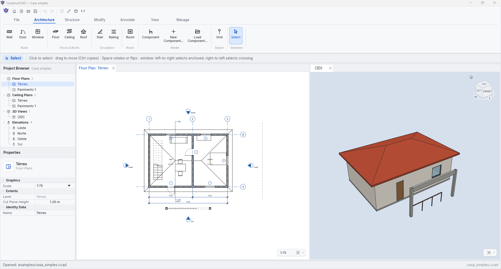
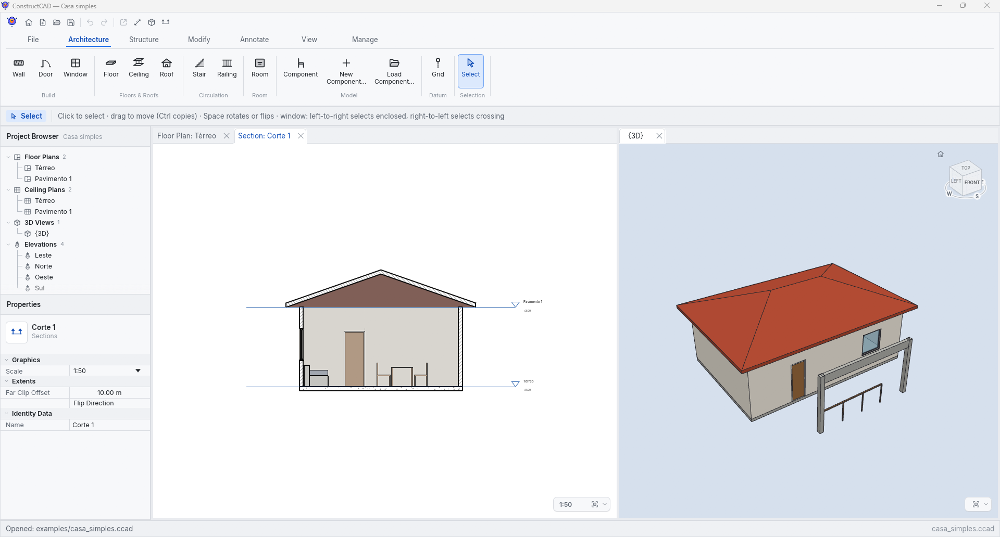
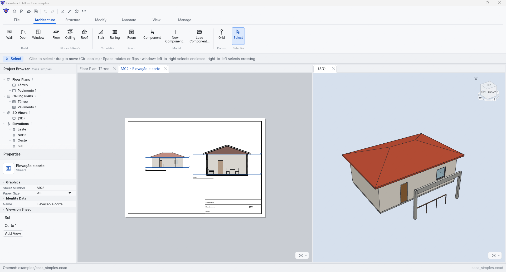
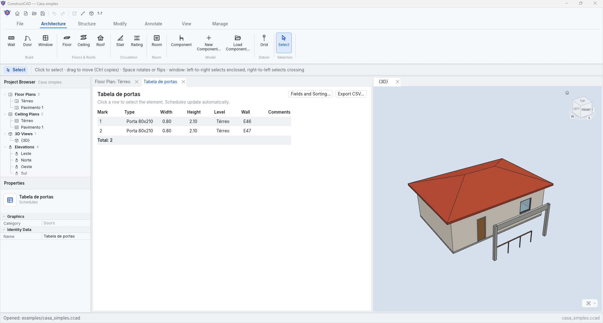

# ConstructCAD

[](https://github.com/francisreboucas/constructcad/actions/workflows/ci.yml)
[](LICENSE)
[](https://www.rust-lang.org/)
[](https://technical.buildingsmart.org/standards/ifc/)
[](#running)
[](CONTRIBUTING.md)

Free and open source **Building Information Modeling (BIM)** software, written in Rust and independent of any commercial vendor.

[Português (Brasil)](README.pt-BR.md) · [Contributing](CONTRIBUTING.md) · [Code of Conduct](CODE_OF_CONDUCT.md) · [Security](SECURITY.md)

A single parametric model is the source of truth. Floor plans, ceiling plans, sections, elevations, 3D views, legends, schedules and sheets are *queries* over that model and update automatically after every change.

## Familiar by design

The menus, shortcuts, panels and tools your hands already know. Productive on day one, no retraining.

ConstructCAD follows the conventions shared by desktop CAD and BIM tools: the quick access toolbar at the top left, a ribbon of tabs, the properties palette and project browser docked at the side, and standard and two-letter keyboard shortcuts. These are general conventions; ConstructCAD does not copy any product's icons, artwork or wording (see [Independence](#independence)).

Every button's tooltip shows its shortcut, what it does, why it is unavailable when it is greyed out, and the engine command behind it. **Ctrl+Shift+P** opens a command palette that finds any command, view or engine command by name; **Ctrl+F1** collapses the ribbon to its tabs. See the [interface guide](docs/interface.md).

## Screenshots



| Section | Sheet | Schedule |
|---|---|---|
| [](docs/screenshots/section.png) | [](docs/screenshots/sheet.png) | [](docs/screenshots/schedule.png) |

## Running

Requires a recent stable Rust toolchain (edition 2024).

```sh
cargo run --release -p cc_app                                    # new project
cargo run --release -p cc_app -- examples/casa_simples.ccad      # open a project
cargo run --release -p cc_app -- examples/casa_simples.ccad --view "Elevação: Sul"
cargo run --release -p cc_app -- --lang en                       # English interface
cargo run -p cc_core --example casa_simples                      # regenerate the example
```

The bundled example project was authored in Portuguese, so its view names are in Portuguese.

## Languages

The interface is available in **English** and **Portuguese (Brazil)**, switchable under *File → Language*. The choice is saved between sessions. On first run the system language is used, and `--lang pt-BR|en` forces a language.

New projects get level, material, type and view names in the active language. Existing projects keep their names, since they are part of the data. The decimal separator follows the language (comma or point).

Translations live in `assets/i18n/*.ftl`. A test ensures every language has the same keys and placeholders. To add a language, create the `.ftl` file and register it in `Language` (`crates/cc_app/src/i18n.rs`).

## Features (MVP)

- **Project browser**: Floor Plans, Ceiling Plans, 3D Views, Elevations (N/S/E/W), Sections, Legends, Schedules and Sheets. The context menu opens, renames, duplicates, deletes and places views on the active sheet.
- **Plan modeling**:
  - Chained walls with automatic L (mitered) and T joins.
  - Wall-hosted doors and windows, with openings cut automatically.
  - Floors, ceilings and roofs (flat or single-slope, with overhang) by sketch or "From walls".
- **Structure and circulation**: columns (rectangular or round, top attached to a level), beams, straight stairs (risers from the type's maximum riser) and railings; *Structure* tab; exported as `IfcColumn`, `IfcBeam`, `IfcStair`, `IfcRailing`.
- **Roofs**: flat, shed, gable and hip (lowest of the planes rising from each eave), with ridges and hips in plan; pitched roofs export as faceted B-reps.
- **Rooms**: click inside room-bounding walls to place a room; its boundary, area and perimeter follow the walls. Room tags in plans, room schedule and `IfcSpace` export.
- **Grids and annotation**: grid lines with bubbles in every plan; aligned, linear, angular, radial and diameter dimensions in any 2D view (*Annotate* tab); single-line and multiline text notes (word-wrapped to a width, rotatable, edited with a double click) with leaders of one or two segments ending in an arrow, open arrow, triangle, dot, circle, square or tick; door and window marks tagged automatically.
- **Parametric components**: furniture, fixtures and casework made of boxes, cylinders and extruded profiles whose sizes are expressions over named parameters (type or instance). A component editor with live checking and plan/front previews, a starter library (table, chair, bed, sofa, toilet, washbasin, wardrobe), the *Component* tool (CM), schedules and legends, `.ccomp` files to share them, and IFC export/import as `IfcFurniture`, `IfcSanitaryTerminal`, `IfcLightFixture` or `IfcBuildingElementProxy`.
- **Materials**: browser with identity, graphics (shading, transparency, surface and cut patterns), render appearance and physical properties; cut patterns show in plans and sections, transparency in 3D.
- **Project units**: millimeters, centimeters or meters (and area, volume, angle, slope and currency formats) with decimals, symbols and digit grouping.
- **Modify tools**: move, copy, rotate, mirror, array, trim/extend, split, offset, align, wall join control and pinning; cut, copy and paste, and match type properties.
- **Navigation and drawing aids**: 3D navigation cube, editable temporary dimensions and angles (type a length, Tab for the angle), alignment guides, Space to rotate or flip.
- **Snapping**: endpoints, midpoints, on wall, 15° angles, Shift for orthogonal, typed length + Enter.
- **Editing**: click or window selection (inside or crossing), drag to move, Ctrl+drag to copy, delete. Undo and redo cover every edit.
- **Properties**: instance and view parameters in collapsible sections; walls with base and top constraints (unconnected height or up to a level), location line, room bounding and structural flags.
- **Types**: Type Properties dialog with duplicate and rename, layer editor with layer functions (core, finishes), wall function and identity data (type mark, manufacturer, model, classification, fire rating, cost…).
- **3D view** (wgpu, MSAA): orbit, pan, zoom, zoom to fit and click selection.
- **Elevations and sections**: hidden line removal, cut hatching and annotated levels.
- **Schedules** for every model category and rooms: choose and order the fields (instance, type and computed values such as length, area and volume), sort, filter, show totals and export to CSV.
- **Sheets** A0–A4: title block with project data and draggable, scaled viewports; export to vector PDF and SVG (*File → Export PDF/SVG…*), identical to the screen.
- **Manage**: project information, levels (each new level creates its plans) and materials.
- **`.ccad` files**: versioned, human-readable RON; saving is atomic.
- **IFC4 export** (*File → Export IFC…*): storeys, walls with openings, doors, windows, floors, ceilings, roofs, structure and components as swept solids (imported objects as polygonal face sets in their original class), with types, material layers, colors and base quantities. Written by ConstructCAD's own STEP writer, with no third-party IFC library.
- **IFC import** (*File → Import IFC…*, IFC2X3 and IFC4) with no class left behind: storeys become levels and grids grid lines; walls, doors, windows, slabs, ceilings, roofs, spaces, columns and beams become native elements with matching or new types, materials and colors whenever a native element can hold their geometry exactly. Every other physical object — stairs, railings, members, plates, curtain walls, MEP segments and fittings, terrain, classes from other schemas — comes in as a generic component that keeps its IFC class, predefined type, property and quantity sets (its own and its type's, converted to SI units) and exact geometry, and is exported back as the same class; the openings that void it are cut from its geometry. Geometry is read by ConstructCAD's own engine: extrusions (with voids), revolutions, swept disks and profiles, CSG primitives and booleans (union, difference, intersection), half-space clipping, faceted and advanced B-reps, face sets, mapped items, every parametric profile and curves with arcs, conics and B-splines.

## Coming from Revit?

ConstructCAD does not read `.rvt` files. To bring a Revit model in, export it to IFC from Revit (*File → Export → IFC*, IFC4 or IFC2x3) and open the file with *File → Import IFC…*. Storeys, walls, doors, windows, slabs, ceilings, roofs, spaces, columns and beams come across as native, editable elements with their types and materials; everything else comes across as generic objects with their IFC class and geometry, and the import message reports how many.

If you do not have Revit, independent third-party tools can convert `.rvt` files to IFC; check their coverage and license terms yourself. ConstructCAD neither bundles nor endorses them.

## Shortcuts

| Key | Action | Key | Action |
|---|---|---|---|
| WA | Wall | SB | Floor |
| DR | Door | FO | Ceiling |
| WN | Window | TE | Roof |
| CT | Section | MD | Select |
| ZE | Zoom to fit | Esc | Cancel / exit tool |
| Ctrl+Z / Ctrl+Y | Undo / Redo | Delete | Delete |
| Ctrl+S / Ctrl+Shift+S | Save / Save as | Space | Rotate / flip (selection or placement) |
| Ctrl+N / Ctrl+O | New / Open | Ctrl+W | Close project |
| RM | Room | GR | Grid |
| DI | Aligned dimension | CL | Column |
| BM | Beam | ST | Stair |
| RA | Railing | CM | Component |
| MV / CO | Move / Copy | RO | Rotate |
| MM / DM | Mirror (pick / draw axis) | AR | Array |
| TR / TX | Trim/extend to corner / to reference | SL | Split |
| OF | Offset | AL | Align |
| PN / UP | Pin / Unpin | MA | Match type properties |
| Ctrl+X / Ctrl+C | Cut / Copy | Ctrl+V | Paste |
| TT | Text | Ctrl+Shift+P | Command palette |
| Ctrl+F1 | Collapse / expand the ribbon | SA | Select all instances in the view |
| GP / UG | Group / Ungroup | ME | Measure between two references |

2D navigation: the mouse wheel zooms and the middle button pans. 3D navigation: left drag orbits, right or middle drag pans and the wheel zooms.

## Automation (command line and MCP)

Everything ConstructCAD does is meant to be reachable without the interface. The engine (`cc_engine`) exposes the operations as named commands with JSON parameters and a JSON Schema each; the `ccad` tool runs them from the command line, from scripts, or for AI agents as an [MCP](https://modelcontextprotocol.io/) server. The same catalog serves all three. The [automation guide](docs/automation.md) explains it in full and the [command reference](docs/commands.md) lists every command with its parameters.

```sh
ccad commands                                   # list the commands
ccad schema wall_create                         # parameters of one command
ccad -p house.ccad --save run wall_create start=[0,0] end=[5,0] height=2.8
ccad -p house.ccad run elements_list category=door
ccad -p model.ifc --save-as model.ccad run project_info     # import an IFC file
ccad -p house.ccad script build.jsonl           # one {"command": ..., "args": {...}} per line
```

Lengths are in meters, angles in degrees, points `[x, y]`; levels, types, views and materials can be named by id or by name. `element_get`, `type_get` and `view_get` show the `params` that `element_set`, `type_set` and `view_set` change. Each edit is one undo step, and an edit that would leave the model invalid is refused.

To use it from an MCP client (Claude Desktop, Claude Code, IDEs), register `ccad mcp`:

```json
{ "mcpServers": { "constructcad": { "command": "ccad", "args": ["mcp"] } } }
```

or, in Claude Code, `claude mcp add constructcad -- ccad mcp`. One project is open per server session (`project_open`, `project_new`, `ifc_import`, `project_save`).

The desktop app runs on the same commands: its drawing tools, property panel and dialogs change the model through the engine. *Manage → Macros* records what you do as a macro (a script of commands, saved as `.ccmacro`) and plays macros back; `ccad script` runs the same files.

## Architecture

```
crates/
  cc_core    BIM model (elements, types, levels, views), undo/redo transactions, .ccad persistence
  cc_geom    derived geometry: walls with joins and openings, slabs, roofs, cuts, picking
  cc_views   2D drawing generation (plan, ceiling, elevation, section, axonometric, legend), schedules, sheet composition and PDF/SVG export
  cc_render  offscreen wgpu 3D renderer
  cc_ifc     IFC4 export and IFC2X3/IFC4 import: STEP writer and parser, model mapping
  cc_engine  every operation as a named command with a JSON Schema, on a session without GUI
  cc_cli     `ccad`: command line, scripts and MCP server over the engine
  cc_app     eframe/egui application: ribbon, browser, properties, tools, sheets
assets/i18n  translations (pt-BR, en); interface text is never hard-coded
```

Every change goes through `Document::edit`, which records a reversible `Transaction`. Continuous edits (dragging values) are merged into a single undo step.

## Development

```sh
cargo test --workspace
cargo clippy --workspace --all-targets -- -D warnings
cargo fmt --all -- --check
CC_UI_SNAPSHOTS=1 cargo test -p cc_app snapshots    # interface screenshots (see docs/interface.md)
```

IFC exports are validated in CI with [IfcOpenShell](https://ifcopenshell.org/), an independent open-source reference used only for testing:

```sh
pip install -r scripts/requirements-ifc.txt
cargo run -p cc_ifc --example export_ifc -- examples/casa_simples.ccad casa_simples.ifc
python scripts/validate_ifc.py casa_simples.ifc
```

See [CONTRIBUTING.md](CONTRIBUTING.md) for the workflow and project rules.

## Roadmap

- Component arrays, nested components and hosted components (on walls and ceilings).
- Native (editable) import of stairs and railings.
- Run a macro as a single undo step; parameters in macros.
- Material textures.

## Independence

ConstructCAD is independent. Behaviour is designed from public documentation, general CAD conventions and user feedback. Reference tests use analytic values and open-source tools. ConstructCAD is not affiliated with, sponsored by or endorsed by Autodesk. Autodesk and Revit are trademarks of Autodesk, Inc.

## License

Copyright © Francis Rebouças <francisreboucas@gmail.com>.

ConstructCAD is licensed under the [GNU General Public License v3.0 or later](LICENSE) (GPL-3.0-or-later).

The application icon is by [Magnific – Flaticon](https://www.flaticon.com/) (see `assets/icons/FLATICON.txt`). The bundled [Inter](https://rsms.me/inter/) typeface is © The Inter Project Authors and licensed under the [SIL Open Font License 1.1](assets/fonts/OFL-Inter.txt).
